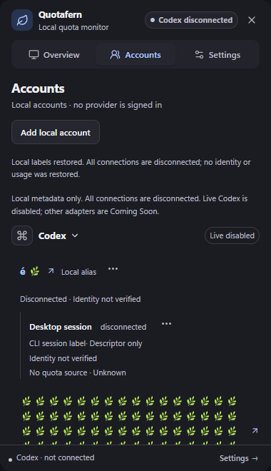
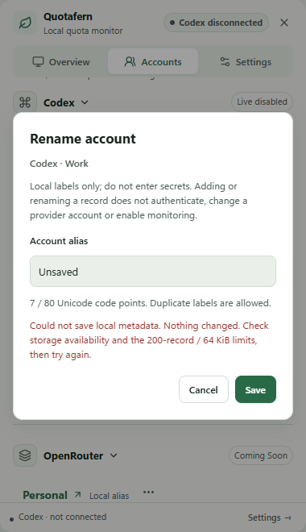
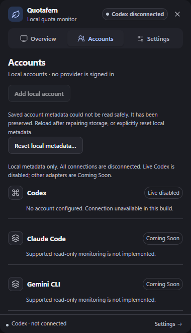

# ACC-04 · Local account management

Baseline main: `9f6497b65188496fe9786787a75da6e7ce0fd5bf`. This milestone manages local metadata only. Adding an account or a connection descriptor never authenticates, discovers credentials, starts a provider process or creates quota readings.

The app supports multiple independent catalog-provider accounts, local aliases, connection mechanism labels and optional local workspaces using ACC-01's unchanged version 1 envelope. Duplicate aliases remain distinct opaque UUID-backed records. Renaming changes labels without changing navigation IDs. With Demo off, Accounts and Overview use this local graph; Overview has no readings. Synthetic examples and their source navigation remain separate and are never written to account storage.

## Persistence boundary

See the [preimplementation design and threat review](plan.md). One app-origin key, `quotafern.account-presentation.v1`, stores only account/workspace/connection IDs, ownership, aliases, provider IDs and mechanism descriptors. The strict codec enforces exact keys, parent ownership, 200 records per collection and 65,536 UTF-8 bytes. Appearance and palette keep their separate existing keys. No new native storage permission or dependency is needed.

localStorage is plaintext and user editable. It protects neither against local malware nor a compromised renderer. Labels must be non-sensitive; a user can choose to type sensitive text into any label. No field collects a key, token, credential locator or OAuth grant. Metadata validation supplies structural integrity, never authentication or authorization. Alias validation also rejects invisible fillers/word joiners/bidi formatting while retaining valid Unicode, emoji joiners and variation selectors.

All startup connections are reconstructed disconnected with generation zero, no consent, no authorization, no verified identities and no source/activity values. There is no implicit F3 migration, automatic connection or remembered consent. Only the codec's explicitly defined synthetic v0 envelope can migrate, and v1 must save before its allocated IDs are exposed.

Writes validate and save before committing visible state. A storage exception leaves the dialog and input available with an error. Corruption, oversize, unknown versions and read failures block editing. Rejected bytes are preserved and never logged. A confirmed reset replaces only the metadata namespace; Cancel preserves it. If the initial read itself fails, reset is unavailable. An intervening storage edit blocks overwriting it and requests reload. This is a single-window adapter with best-effort conflict detection, not multi-writer database isolation.

## Functional action matrix

| Action                          | Available behavior                                                          | Identity / scope                                   |
| ------------------------------- | --------------------------------------------------------------------------- | -------------------------------------------------- |
| Add local account               | Catalog provider plus validated alias; explicit disconnected record         | New account UUID; no automatic connection          |
| Add local connection descriptor | Alias, provisional CLI/API-key/OAuth mechanism, optional owned workspace    | Independent connection UUID; no credential field   |
| Add local workspace             | Optional label within Add descriptor                                        | New workspace UUID owned by that account           |
| Rename account                  | Complete current alias, Save/Cancel, inline validation                      | Account ID and connections unchanged               |
| Rename connection / key label   | Independent complete label, Save/Cancel                                     | Connection ID, owner and mechanism unchanged       |
| Remove local account            | Confirmation names provider/account and counts owned connections/workspaces | Only target and its owned metadata removed         |
| Remove local descriptor         | Confirmation names owner and full label                                     | Only target connection removed; workspace retained |
| Reset unreadable metadata       | Explicit destructive confirmation; Cancel available                         | Only metadata key replaced; appearance preserved   |

Actions use keyboard-accessible Bits UI menus and native modal dialogs, explicit Tab wrapping, IME-safe Enter, Escape cancellation and polite status/error announcements. Rename returns focus to its menu trigger. Deletion returns focus to the owner's surviving action, next same-provider account action, provider heading or Accounts heading. Removed Overview contexts fall back to All; removed Details remain unavailable through the existing UX-02C contract. Selection and Back/scroll state remain transient.

## Unsupported and blocked matrix

| Operation                                          | Current status / reason                                                                                                                             |
| -------------------------------------------------- | --------------------------------------------------------------------------------------------------------------------------------------------------- |
| Real provider connect/authentication               | Unavailable for every provider; Codex Live disabled, other catalog providers Coming Soon                                                            |
| Real API key/OAuth grant/session entry             | No input, import, reveal, generation or storage path                                                                                                |
| Native-managed or previously active record removal | Blocked without native cleanup authority; active, consented, advanced generation, diagnostic, identity/source or pending-cleanup states fail closed |
| Disconnect native monitoring / provider logout     | No local management operation invokes either; no local session exists to disconnect                                                                 |
| Remember connection / startup reconnect / polling  | Not activated                                                                                                                                       |
| Workspace rename / standalone workspace deletion   | Deferred; account removal removes its owned workspaces                                                                                              |
| Unknown catalog provider restored from valid v1    | Retained as Coming Soon; no adapter inferred                                                                                                        |
| Native coordinator / multi-login isolation         | Future ACC-02/F4 contract; local runtime guards are not native cleanup receipts                                                                     |

The local controller has no native runtime ingestion API and never calls ACC-01's synthetic cleanup-acknowledgment helpers. It creates/restores descriptor-only state. A future native integration must replace this boundary with a coordinator that owns cancellation, pending consent, process containment, generation routing and cleanup receipts. A renderer-generated generation or acknowledgment cannot establish termination.

## Actual screenshots

Compiled-production Svelte captures, not mockups or native GUI acceptance:

| Local accounts                                             | Save failure                                                                | Corrupt metadata recovery                                                            |
| ---------------------------------------------------------- | --------------------------------------------------------------------------- | ------------------------------------------------------------------------------------ |
|  |  |  |

Additional source/production captures cover both palettes, light/dark, all 320/380/420 × 480/660 dialog sizes and source-specific demo navigation. [Validation](validation.md) · [Review dispositions](review.md).

## Remaining acceptance and integration limits

Both live gates remain false. SEC-01/SEC-02 monitoring grant, Codex startup policy, Unix forced-parent cleanup and provider-specific multi-account authorization remain unresolved. No raw credential lifecycle or app-owned secret storage is implemented. No F4, REL-01/REL-02, updater, release, merge, publishing or deployment is included; Draft PR #11 is untouched.

Combined owner Windows native acceptance remains deferred until after UX-02B/C, ICON-01 and ACC-04. Actual native WebView restart durability, tray/Show/Hide/Quit/focus, native popup Escape, OS text scaling, DPI/monitor changes and real assistive-technology speech remain pending. macOS/Linux native GUI acceptance is NOT RUN. Browser reload and hosted desktop compilation are separate evidence.
