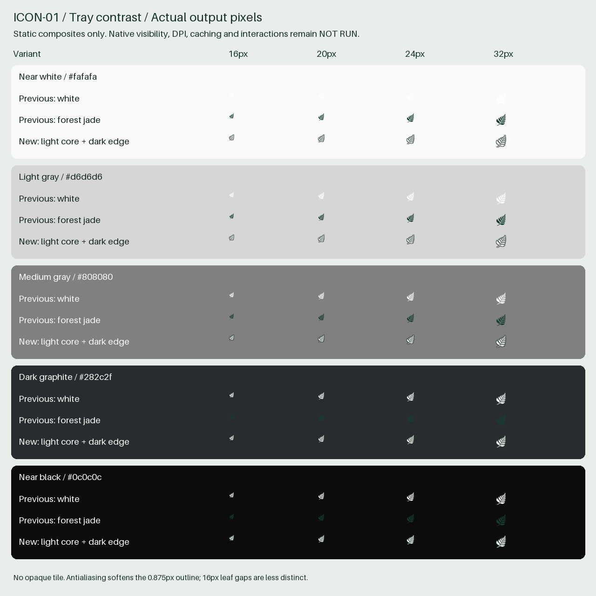

# ICON-01 final review fixes

This follow-up updates existing Draft PR #9 from reviewed HEAD `95b94419aca4dc4321da38b8a268eceb7d337610`. It does not create a replacement PR or change PR #8. The lead model/effort configuration cannot be independently verified; the focused final reviewer is configured as GPT-6 Luna / High. No escalation to Extra High is requested.

## Findings and resolution

The [independent review](https://github.com/wihlarkop/quotafern/pull/9#pullrequestreview-5642328498) identified an Important visibility limitation (white Windows/Linux glyph on light taskbars) and Minor provenance-path hygiene (absolute owner-machine location in README and source inventory). Reviewed-HEAD CI [40176575900](https://github.com/wihlarkop/quotafern/actions/runs/40176575900) was independently verified successful in all four jobs: frontend, Windows, macOS and Linux. That result applies to the old HEAD, not these fixes.

1. Windows/Linux now compile in a static dual-tone fern: a light interior with a restrained dark edge. The original approved per-size fern alpha is the only shape source. macOS separately compiles in the unchanged white monochrome source and retains native template rendering. No shell-theme inference, registry access, image switching, polling or new permissions.
2. README and source-inventory metadata now use `<owner-local-extracted-assets>`. Relative pack paths, all 41 original file records/hashes/dimensions and the statement that the ZIP was unavailable remain intact. Added-line scanning covers the entire PR diff; Bun regression scans current ICON-01 textual evidence for drive/home paths. The PR description is also updated to remove the old absolute location. Original asset bytes are unchanged; no history rewriting or editing others' review comments is performed.

## Exact deterministic derivation

[derive-tray.py](derive-tray.py) is an offline asset compiler using Python and Pillow 12.3.0, not an application/runtime dependency. It reads only repository-relative approved source masks and writes four neutral PNGs, the installed inventory and static contrast evidence. It never rewrites the source masks, app icons or favicons. Reproduce with `python docs/icon-01/derive-tray.py` in an offline environment with the recorded Pillow encoder stack, then use `bun run fmt` for JSON formatting. PNG byte hashes identify the actual committed encoder output.

For each of 16/20/24/32px:

- Read alpha from the unchanged `src-tauri/icons/tray/fern-dark-<size>.png`.
- LANCZOS upscale the alpha by 8. Apply a square MaxFilter(15), a 7/8 = 0.875px dark expansion around the supplied mask, including leaf gaps.
- Put the expanded alpha under RGB `(23,40,34)`. Composite the unchanged upscaled source alpha as the light interior RGB `(248,249,246)`.
- LANCZOS downsample to the original target size; clear only the exterior one-pixel alpha border to remove resampling fringe. Retain the original canvas/padding and transparent exterior rather than adding an opaque tile.
- Save RGBA PNG with compression level 9, optimization disabled. Record the exact source SHA-256, destination SHA-256, dimensions and operation in [installed-assets.json](installed-assets.json).

All **24 original installed asset hashes remain unchanged**. Four derived rows bring the installed inventory to **28**. The [source inventory](source-inventory.json) still describes the original **41** owner-supplied files, with a portable root label; derived assets are deliberately not misrepresented as supplied originals.

## Actual tray comparison and contrast

The sheet composites the actual output PNG files at their native pixel sizes. It is static asset evidence, not a screenshot of any OS tray. It compares previous white and forest-jade masks with the new neutral fallback over near white, light gray, medium gray, graphite and near black. The original [before/after sheet](before-after.png) is retained unchanged as historical evidence of the original fallback limitation.

At 20/24/32px the neutral outline and light interior keep the fern leaf/stem direction recognizable across these flat backgrounds. At 16px the leaf gaps are less distinct and antialiasing softens the edge; this is the bounded trade-off for one static asset. The dark edge separates the silhouette on light backgrounds; the light interior separates it on dark backgrounds. It remains visually consistent with the supplied fern shape, without a tile, decorative shadow or animation. This is improved coverage across tested backgrounds, not a claim of universal contrast over arbitrary textured/translucent panels or OS scaling.

Relative luminance is computed from sRGB using the standard piecewise transfer function and weights 0.2126/0.7152/0.0722; ratio is `(Lmax + 0.05) / (Lmin + 0.05)`. [Metrics](tray-contrast.json) include ideal opaque fill/edge ratios plus the actual alpha-composited raster peak/counts at each size. Antialiased edge pixels have lower contrast than ideal opaque colors; a peak ratio does not describe the complete silhouette or establish native visibility or accessibility compliance.

| Background    | Opaque light interior ratio | Opaque dark edge ratio | Actual 16px peak ratio |
| ------------- | --------------------------- | ---------------------- | ---------------------- |
| Near white    | 1.012                       | 14.761                 | 7.625                  |
| Light gray    | 1.375                       | 10.600                 | 5.718                  |
| Medium gray   | 3.737                       | 3.901                  | 3.515                  |
| Dark graphite | 13.323                      | 1.094                  | 12.418                 |
| Near black    | 18.511                      | 1.270                  | 17.100                 |

## Validation of this follow-up

| Check                                                      | Result                                                                                                                                                           |
| ---------------------------------------------------------- | ---------------------------------------------------------------------------------------------------------------------------------------------------------------- |
| Frozen Bun 1.4.4 install                                   | PASS; no dependency/lockfile changes                                                                                                                             |
| Oxlint / Oxfmt                                             | PASS; final evidence checked                                                                                                                                     |
| Svelte diagnostics / production frontend build             | PASS; 0 errors, 0 warnings                                                                                                                                       |
| Full frontend regression                                   | PASS; 13 groups / 1,001 assertions                                                                                                                               |
| Rust fmt/check/Clippy                                      | PASS                                                                                                                                                             |
| Rust synthetic regression                                  | PASS; 57 passed / 4 ignored fixture entry points / 0 failed                                                                                                      |
| Unbundled Windows desktop compilation                      | PASS; optimized executable compiled, no GUI launch or packaging                                                                                                  |
| Original asset/source records and new PNG CRC/decode/alpha | PASS; all 24 original hashes, 41 records and 12 tray decodes; offline repeat reproduced four neutral PNGs/contact-sheet bytes and inventory/metrics data exactly |
| Built favicon references                                   | PASS; all four local assets remain byte-identical                                                                                                                |
| Security/protected resource diff                           | PASS; both live gates false, protected owning files unchanged                                                                                                    |
| Focused independent GPT-6 Luna / High review               | PASS; no Critical/Important/Minor findings, no declined judgments; read only                                                                                     |
| New exact-HEAD hosted CI                                   | Pending push; report observed state in PR description without waiting indefinitely                                                                               |

Rust regressions decode all twelve original/derived tray PNGs, enforce exact dimensions and a transparent exterior border, check monochrome source versus dual-tone color roles, and exercise the platform-compiled selection. Bun regression checks installed/source hashes, exact tray dimensions, PNG headers, ICO/ICNS bounds, bundle references, unchanged local favicon references, platform asset mapping and portable evidence paths. The one-time offline check also verifies PNG CRCs/IEND and original-byte preservation. No real provider/authenticated process or native GUI acceptance is run.

## Native acceptance and security remain deferred

Combined Windows native acceptance remains scheduled **after ICON-01, UX-02B/C and ACC-04**. Real taskbar themes, DPI/monitor combinations, shell icon caching and popup/tray interactions are **NOT RUN**. macOS/Linux native GUI appearance is **NOT RUN**; suitable devices are unavailable. The monochrome macOS template selection is source/compile/test evidence only. Static raster comparison and hosted compilation do not establish OS visual acceptance. No packaged release is authorized.

`LIVE_CONNECTION_ENABLED = false` and `CODEX_CONNECTION_AVAILABLE = false` remain unchanged. No IPC/capabilities/CSP, credentials/auth, provider/network permissions, process containment/lifecycle, persistence, telemetry or automatic polling changes. F4 startup-policy/Unix forced-parent-termination blockers and SEC-01/SEC-02 gates remain unchanged. PR #8 is preserved on `codex/ux-02a-soft-native` at `49162f948311470b0e02dbf9274633940e848ef0`; its worktree is inspected read only and remains clean.

## Modified files

- `docs/icon-01/README.md`
- `docs/icon-01/changed-files.txt`
- `docs/icon-01/derive-tray.py`
- `docs/icon-01/final-review.md`
- `docs/icon-01/installed-assets.json`
- `docs/icon-01/source-inventory.json`
- `docs/icon-01/tray-contrast.json`
- `docs/icon-01/tray-contrast.png`
- `scripts/icon-regression.ts`
- `src-tauri/icons/tray/fern-neutral-16.png`
- `src-tauri/icons/tray/fern-neutral-20.png`
- `src-tauri/icons/tray/fern-neutral-24.png`
- `src-tauri/icons/tray/fern-neutral-32.png`
- `src-tauri/src/lib.rs`

[changed-files.txt](changed-files.txt) lists the complete PR scope against its verified main baseline. The exact final HEAD and hosted run snapshot are recorded in the Draft PR description so this source file does not attempt to embed its own commit hash. Keep PR #9 Draft and unmerged; stop after owner handoff.
