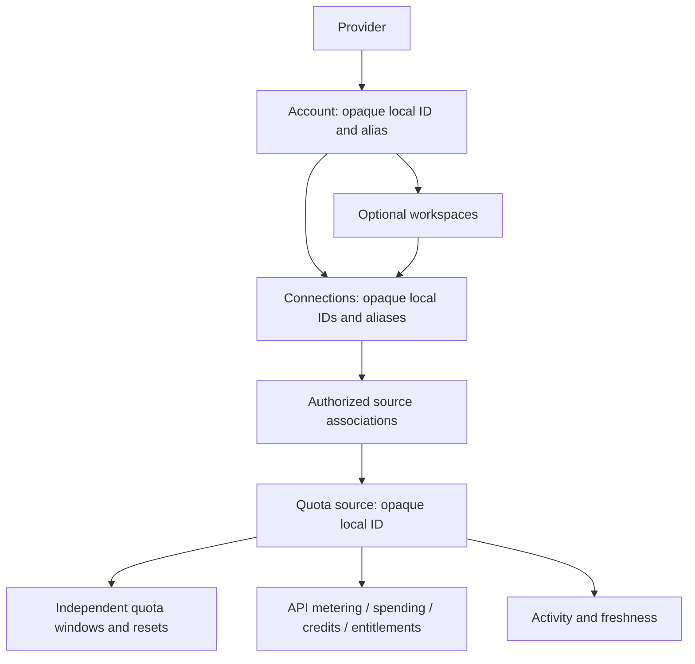

# ACC-01 multi-account architecture

Date: 2026-10-25. Additive foundation based on `3b5b9d910a4cb9c3d7568bf6ca756aaef383c968`.

## Delivery boundary

`src/lib/accounts/` is an independently testable TypeScript domain and sanitized presentation contract. It is deliberately not imported by the production Svelte application or Rust bridge yet. F3's single `CodexBridge`, `codexSnapshot`, native consent, manual refresh, snapshot normalization and disconnected startup remain unchanged. `LIVE_CONNECTION_ENABLED = false` and `CODEX_CONNECTION_AVAILABLE = false` remain unchanged. There is no new adapter, IPC command, capability, CSP allowance, network access, storage call or credential access.

This model represents future providers and connections; it does not prove authorization, concurrent logins, CLI profile isolation or a monitoring grant. Every catalog provider has `monitoring: false`; multi-account, workspace and multi-key support are unverified. Codex is gated; all others are Coming Soon. New provider IDs can be represented without implementing an adapter. OpenCode's upstream provider and billing identity must be resolved by a future reviewed adapter, never inferred from its client name.

## Ownership and identifiers

Provider IDs are stable machine slugs, independent of display names. Account, workspace, connection, source and window IDs are kind-prefixed UUIDv4 values generated using `crypto.randomUUID()`. They never derive from aliases, emails, API keys or provider credentials. IDs are globally unique within each entity kind in a metadata graph: an account or connection ID collision across providers is rejected, not merged. A future native coordinator must also reject collisions and bind every command/result to provider, account, connection and generation. Local IDs are routing identifiers, never credentials or consent tokens.

An account belongs to exactly one provider; a workspace belongs to one account; a connection belongs to one account and optionally one of that account's workspaces. Connections have a mechanism descriptor (`cli-session`, `oauth-grant`, `api-key`), never key material, key fragments or a filesystem locator. A source has an explicit provider, account and optional workspace. Cross-account/workspace associations fail closed. Cross-account shared billing is intentionally unsupported in ACC-01: leave the relationship unknown until a reviewed ownership model supports that provider case. Do not duplicate a known shared cross-account balance into account totals.

`QuotaSource.authority` indicates an authorized provider read or synthetic fixture; `origin` independently identifies live versus synthetic presentation. Both must agree. Source identity and origin cannot be reassigned to another owner through an update. Each quota window has its own opaque ID, label, remaining percentage, duration and reset time. Null remains unknown and confirmed zero remains zero. Credits retain provider-credit units, API usage retains tokens/requests, spending retains decimal strings and optional explicitly reported currency. No arithmetic converts tokens into money or adds percentages, currencies, resets or credits. Missing calendar days remain absent/unknown; confirmed zero is explicit. No inferred streak, price or entitlement is introduced.

### Association and freshness

A verified association may list multiple authorized connections within the same account/workspace. Every link carries its native-validated current generation in `connectionGenerations`. Stale evidence for any linked connection is discarded, even when the publishing connection's generation is current; reconnecting a key requires fresh shared-authority evidence. The adapter must establish the shared authority using documented provider evidence; matching names, identity text, equal amounts or timestamps are insufficient. A source appears once in Overview even when two keys refer to it. Connection filters show the same source ID, with its ownership intact.

An unknown association has exactly one observing connection. Other observations remain independent rows labeled relationship unknown, with no assumption that their balances are shared or separate. Overview always returns `totals: null`, including for verified sources: ACC-01 avoids arithmetic aggregation entirely. Future totals require separate rules for compatible measures and provably complete source coverage.

Freshness belongs to each source, not the provider group. `fetchedAtMs`, freshness state and `staleAfterMs` are independent of connection lifecycle. `sourceAt` ages current data with a supplied clock, without provider calls or state mutation; future timestamps and invalid clocks become stale. Older observations cannot replace newer values of the same source. A future request coordinator must serialize reads within a connection and preserve stable source/window IDs for the same authority; the fixture allocator does not discover provider authority.

## Lifecycle and security boundaries

`restoreState` always creates disconnected connections with no consent, no authorization, no identity, no source values and generation zero. Opening views is pure and cannot connect or query a provider. `beginAuthorizedSession` is a contract-only transition for a future native-authorized coordinator. A renderer Boolean or this function's existence cannot authorize native operations. No current app path calls it.

Disconnect immediately advances only the target generation, revokes consent/authorization, removes its identity and source links, and clears last success. Other authorized links to a verified shared source remain intact. Authentication expiry or errors are static diagnostic categories and affect only that connection. This foundation clears target values on failure; F3's existing stale last-known behavior is untouched. A future adapter may add a separately tested stale-refresh transition while retaining account-generation checks. Late results from disconnected, removed or reconnected generations are discarded. Alias changes never touch this state or source associations.

Account removal is two phase:

1. `prepareAccountRemoval` revokes every owned connection, clears/hides owned values, advances generations and marks the account removing. Reconnect and edits are blocked.
2. A future native coordinator invalidates pending consent, cancels pending requests and confirms bounded process/session cleanup for every connection.
3. `finishAccountRemoval` requires acknowledgements matching all current revoked generations, then deletes owned metadata/workspaces/runtime. Missing cleanup leaves a visible pending account; it must never silently claim removal succeeded. Single connection removal similarly requires disconnected state and matching cleanup generation.

The acknowledgement objects are synthetic contract evidence, not security receipts. TypeScript cannot terminate or prove termination of a native subprocess. A future native implementation must own the barrier and acknowledgements; renderer-supplied values must not be trusted. Disconnect never calls provider logout, deletes an API key, changes an external application's active account or affects another connection.

Verified display identity is separately authorized, ephemeral and connection scoped. Setting identity and reporting failure both require the current generation; late callbacks cannot alter a reconnected session. Each connection retains its own identity. An account/workspace header may show a verified label only when the selected context contains exactly one connection; multiple connections never collapse identities by matching display text. Identity is cleared on disconnect and never persisted. No raw provider identity or protocol blob is accepted by the metadata codec. Typed runtime contracts assume separately sanitized adapter input; they are not a generic untrusted JSON parser or RPC proxy. A future native adapter must allowlist fields, bound payload sizes and redact provider text before constructing them. View projections clone source/runtime values so a consumer cannot accidentally mutate the domain state.

## Alias and persistence contract

Aliases are NFC-normalized, trimmed, nonempty, at most 80 Unicode code points, and reject control characters, bidi overrides and selected invisible text. Unicode and emoji, including composed sequences, are allowed. Duplicate aliases are valid. Long valid names remain available in full in the future rename form; displays can wrap or truncate with an accessible full name. Aliases are literal text, never HTML, identity matches, key fragments or authorization input. Users should choose non-sensitive names; a local label cannot be mechanically guaranteed free of text a person elects to type.

`AccountMetadata` version 1 contains only account `{id, providerId, alias}`, workspace `{id, accountId, alias}` and connection `{id, accountId, workspaceId, alias, mechanism}` records. Structural IDs and mechanism labels make alias routing durable but contain no secret. No consent, authorization, login state, verified identity, source mapping, quota/activity history, billing, credentials, errors or runtime generation persists. Only existing appearance/palette preferences are actually stored by this build.

`readMetadata`/`writeMetadata` are pure codecs, with no localStorage/filesystem side effects. They enforce exact keys, opaque ID syntax, parent ownership, unique IDs, canonical aliases, 200 records per collection and a 64 KiB UTF-8 envelope limit. Invalid JSON, unknown versions, extra fields (including secret-looking fields), orphan or duplicate IDs, malformed and oversized records reject the entire envelope and return empty metadata with `status: invalid`. Never silently merge by alias or partially restore an ambiguous graph. The caller must show a static recovery message, without logging rejected text. Duplicate aliases retain separate IDs and are not an error.

Storage activation is deferred to ACC-02/04 with an explicit persistence review, deletion/retention behavior and user-visible recovery. Proposed future key: `quotafern.account-presentation.v1`, separate from appearance and palette. Do not add new presentation preferences until their allowlist, defaults and validation are reviewed. OS-protected app-owned credential storage belongs to ACC-03/SEC-02, not this codec. Never inspect/copy third-party CLI credentials.

## F3 migration strategy

There is no persisted F3 account/session record to migrate: existing installs retain appearance/palette and start with empty multi-account metadata. ACC-01 neither reads `codexSnapshot` from storage nor invents a configured account from the disconnected F3 card. The codec has a deliberately narrow synthetic legacy format (`version: 0`, `accountAlias`, `connectionAlias`) to test explicit migrations. It creates new opaque account/connection IDs once, validates aliases, and restores disconnected. This is not claimed as a historical shipped schema. Save successful v1 metadata atomically before treating those IDs as durable; a repeated v1 read preserves them.

Future runtime cutover, separately reviewed:

1. Keep native and frontend live gates closed. Stop any active native session and invalidate outstanding consent/results before changing ownership.
2. Replace the single global snapshot with a context-indexed presentation store behind native-owned session/generation routing. Associate the existing F3 contract only with an explicitly selected local Codex account/connection. Never derive identity from the current CLI login or alias.
3. Discard prior ephemeral snapshots, identities, source associations and consent. Do not blindly replay one snapshot into multiple accounts. Allocate local records only through explicit Add actions and approved provider-specific authorization.
4. Map sanitized F3 quota/monitoring fields into distinct source/window IDs only after an authorized native binding establishes the owner and authority. Preserve current null/unit/freshness and no-demo-fallback semantics. F3 does not expose verified billing identity, so do not claim shared billing from its display labels.
5. Before supporting two live Codex accounts, prove officially supported session/profile isolation and cleanup without changing another CLI's login. Do not spawn the current single CodexBridge twice against a shared credential store.
6. Require synthetic protocol, direct-IPC isolation, cancellation/removal races, startup-policy and Unix parent-death security acceptance. Rollback leaves all connections stopped and consent absent; no automatic reconnect or background polling.

## Test and review evidence

`scripts/accounts-regression.ts` runs through the existing `bun run regression` command. It uses only fixed synthetic metadata, quotas, keys-as-descriptors and cleanup acknowledgements, including two Codex accounts, two API-key connections, workspace isolation, shared and unknown billing, migration, aliases, ownership collisions, filters and late results. No fake credential is used to authenticate anything.

See [validation evidence](../validation/acc-01-validation.md), [future UX acceptance](acc-01-ux-contract.md), provider roadmap (archived visual removed) and security gates (archived visual removed). F4 startup-policy and Unix forced-parent termination remain blocked. macOS/Linux native GUI behavior remains NOT RUN; compilation is separate evidence.
