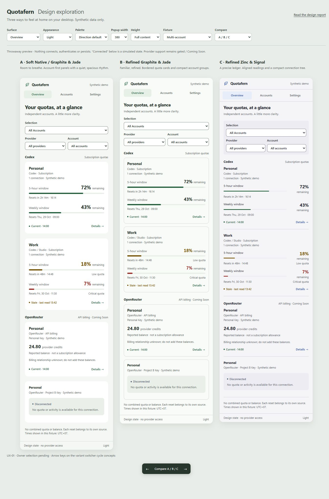
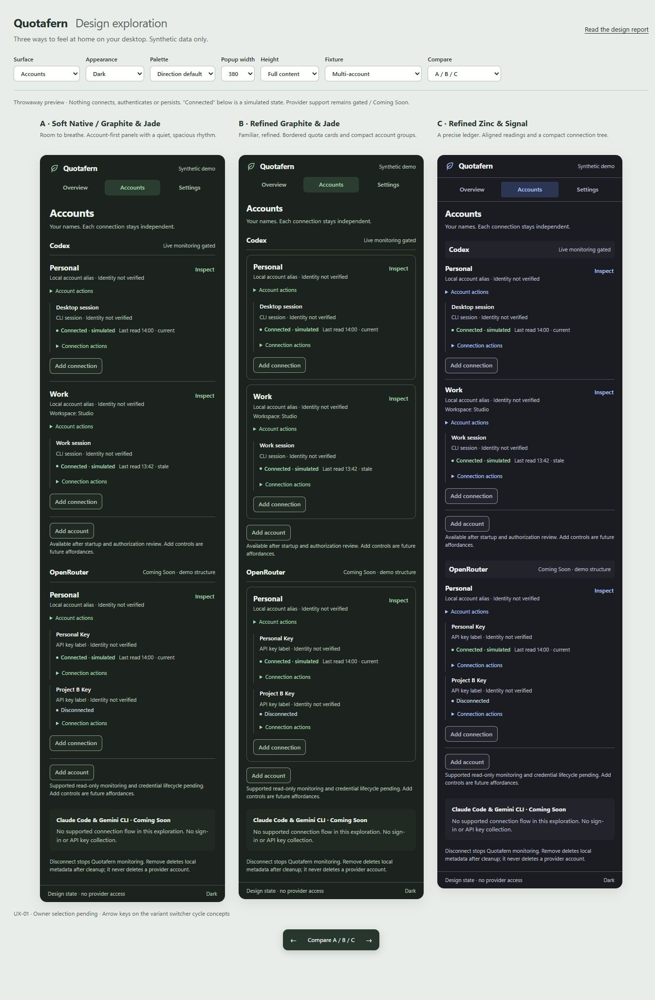
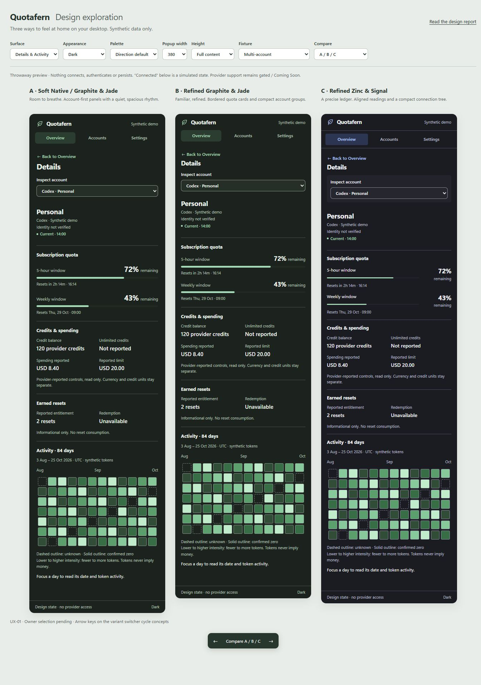

# UX-01 · Soft Native design exploration

Date: 25 October 2026. **Design artifacts only. Owner selection pending.**

Three comparable Quotafern directions are available in a working, isolated browser prototype. Nothing here enables monitoring or implements UX-02 / ACC-04. All identities, statuses, balances, activity and timestamps are invented. No live provider was contacted.

## Review the designs

From this branch, run:

```powershell
bun install --frozen-lockfile
bun run dev:ux
```

Open [the local comparison](http://127.0.0.1:4174/). It starts with Overview, all three directions, 380px frames and a synthetic multi-account fixture. The owner requested this side-by-side review flow. Use the top controls for surfaces, states, dimensions, appearance and palette; use the bottom arrows to isolate a direction. URL parameters retain review configuration only. Account selection, names and simulated lifecycle changes stay in memory and reset on reload. No browser storage is used.

Useful starting points:

- [Overview · full comparison](http://127.0.0.1:4174/?screen=overview&height=full&variant=all)
- [Accounts · full comparison](http://127.0.0.1:4174/?screen=accounts&height=full&variant=all)
- [Details & Activity · dark](http://127.0.0.1:4174/?screen=details&mode=dark&height=full&variant=all)
- [Settings](http://127.0.0.1:4174/?screen=settings&height=full&variant=all)
- [320px · short height · Unicode aliases](http://127.0.0.1:4174/?screen=accounts&width=320&height=480&fixture=unicode&variant=all)
- [Shared API billing source](http://127.0.0.1:4174/?screen=overview&fixture=shared&height=full&variant=all)

`Full content` expands the frames for inspection and screenshots. The actual native popup remains 380 × 660, resizable from 320 to 420px with a 480px configured minimum height; this preview also offers those bounded frames. The surrounding review toolbar is outside the proposed product UI.

## Visual comparison

These are actual browser captures of `index.html`, `preview.js` and `preview.css`, not generated mockup images. Each comparison places A, B and C from left to right. The full Accounts captures include both Codex accounts and the two independently named OpenRouter connections.







| Surface            | Light                                       | Dark                                       |
| ------------------ | ------------------------------------------- | ------------------------------------------ |
| Overview           | [380px](screenshots/overview-light-380.jpg) | [380px](screenshots/overview-dark-380.jpg) |
| Accounts           | [380px](screenshots/accounts-light-380.jpg) | [380px](screenshots/accounts-dark-380.jpg) |
| Details & Activity | [380px](screenshots/details-light-380.jpg)  | [380px](screenshots/details-dark-380.jpg)  |
| Settings           | [380px](screenshots/settings-light-380.jpg) | [380px](screenshots/settings-dark-380.jpg) |

Additional captures and measured evidence are indexed in [validation](validation.md). The [unchanged baseline capture](screenshots/baseline-disconnected-380.jpg) shows the current production browser UI before any design implementation. Comparing it with the proposed Overview/Accounts captures demonstrates the scope of future migration; the baseline has no production multi-account screens.

## Three directions

### A · Soft Native / Graphite & Jade

The account alias leads. Soft raised source panels create clear independent ownership, with 20px content gutters, 16px panel padding, a 22px surface heading and generous 20px separation. A subdued leaf and jade selection preserve Quotafern's identity. Status colors remain independent of the brand accent. Accounts uses simple divided groups rather than another layer of nested cards.

This feels most comfortable for a quick check of one or two subscriptions. The cost is vertical space: the complete 380px multi-account Overview measures 1,516px tall, so a bounded 660px popup shows one complete source before scrolling. It needs the strongest filter discipline as the account list grows. This is an observed layout trade-off, not a latency or usability-study result.

### B · Refined Graphite & Jade

Preserve the incumbent top tabs, bordered provider-card vocabulary and stacked sections. Use a smaller 18px heading, 16px gutters, 13px card padding and 12px source gaps. Numeric values remain aligned, but compact framing gives more room to content. Accounts uses a bordered account container with clearly indented connection labels.

This is the lowest structural migration cost and likely the easiest to maintain against the current components. Its full Overview is 1,409px tall, about 7% shorter than A under the identical fixture. The trade-off is more visible borders and less distinction between routine account checks and detailed management. Multiple account cards can feel repetitive.

### C · Refined Zinc & Signal

Use a ledger rather than a panel stack: source headings sit on the base surface, readings align in a narrow right column, meters occupy the left column, and thin horizontal rules separate independent sources. A square-leaning segmented navigation strip and inset provider group headings give it a precise utility character. Accounts reads as a compact provider/account/connection tree. Signal blue identifies navigation and focus; quota states retain green/amber/red/unknown semantics.

Its full Overview is 1,403px tall under the same fixture. That is only slightly denser than B: the extra native-style header separation offsets savings in the ledger. It offers good scan alignment without claiming a dramatic density improvement. The compact numeric columns introduce more responsive CSS and require careful testing when labels or units grow.

## Shared semantic decisions

- **Overview:** All Accounts is a collection, never a combined quota. Provider and account filters show contextual labels; connection/key filters appear for multiple keys. Every quota window has its own percentage and reset. API billing occupies a separate provider section and uses provider-credit units, never a subscription percentage.
- **Source ownership:** verified shared billing appears once with the number of linked connections. Unknown billing displays separate observations and “Billing relationship unknown; do not add these balances.” Matching aliases or amounts never establish ownership.
- **Accounts:** Provider → Account → optional Workspace → Connection. Codex has Personal and Work / Studio. OpenRouter has a Personal account with Personal Key and Project B Key. These are labels, never key contents. Connection status and source freshness are separate. Actions live in visible, keyboard-operable disclosures, with no hover-only affordance.
- **Rename:** separate account and connection workflows. The native HTML dialog names the provider/parent context, selects the complete alias, validates NFC/trim/80 Unicode code points and rejects control/direction characters. Duplicates remain valid and receive local ordinal context. Saving changes only a temporary label. Escape cancels and returns to the trigger.
- **Disconnect/remove:** simulation names the exact target and consequence. Disconnect clears only that connection's values. Removal demonstrates the pending-cleanup barrier and blocks edits. It never claims successful native cleanup or provider-account deletion. Add account/connection are disabled future affordances with a reason; no generic sign-in/key form exists.
- **Details:** provider, alias and optional narrowed connection are explicit. Switching to Work changes its quotas, funding availability and activity pattern. Missing, disconnected, removing and invalid selections show unavailable, never the next account's values. Navigation does not refresh a provider.
- **Activity:** exactly 84 synthetic days, 3 Aug–25 Oct 2026 UTC. Unknown days have dashed outlines, confirmed zero has a solid outline, positive counts use intensity. Each day has a date/count accessible name. A single Tab stop enters the calendar; arrows move by day/week and Home/End select the endpoints. Tokens do not imply money. This prototype preserves the existing semantic intent without replacing the production calendar.
- **Settings:** Follow System, Light and Dark are independent from both palettes. Follow System resolves `prefers-color-scheme` and listens for changes. Explicit Demo preview is separate from authorization. Remember connection is unavailable and unchecked. The existing production preference persistence is untouched.

## Palettes and accessibility

Every direction can be viewed in Graphite & Jade or Zinc & Signal. A and B default to jade; C defaults to signal. Changing the palette never changes status meaning, layout or source ownership. Zinc therefore remains usable with A's softer surfaces; jade works with C's ledger. These are compatible visual grammars, not three permanently coupled theme presets.

The prototype uses the incumbent system font stack, tabular readings, semantic status text, visible 2px focus rings, labeled native selectors, native modal focus containment and one vertical content region per popup. There is no horizontal chip scroller. Long Unicode aliases wrap; native selectors retain the full option text in their accessible names. The dialog width follows the selected popup width. Menus/disclosures and dialogs consume Escape locally; no native hide command is invoked by this preview.

Computed semantic text tokens were checked against surface/raised/inset/selection backgrounds in both palettes and appearances: minimum measured ratio **5.34:1**. This is token contrast evidence, not a whole-application WCAG certification. Focus/keyboard scenarios, viewport measurements and remaining assistive-technology/native gaps are recorded in [validation](validation.md).

## Comparison and recommendation

The judgments below are design review, supported by rendered captures and measurements; no user study or platform certification was performed.

| Criterion                 | A · Soft Native              | B · Refined Graphite          | C · Refined Zinc                           | Evidence / trade-off                                         |
| ------------------------- | ---------------------------- | ----------------------------- | ------------------------------------------ | ------------------------------------------------------------ |
| Information clarity       | Strongest account separation | Familiar grouping             | Strong numeric scan alignment              | Overview captures; same independent window semantics         |
| Multi-account usability   | Calm groups, longer scan     | Explicit account containers   | Clear compact tree                         | Complete Accounts captures, independent statuses and aliases |
| Visual comfort            | Most spacious                | More borders, tighter rhythm  | Quiet ledger, firmer chrome                | Light/dark captures; 20px vs 16px content gutters            |
| Accessibility             | Largest default heading      | Same semantics, smaller type  | Strong focus, smaller labels               | Contrast and keyboard evidence; no automated certification   |
| Compact effectiveness     | More scrolling               | Best familiar compromise      | Slightly shorter full Overview             | 1,516 / 1,409 / 1,403px at 380px under the same fixture      |
| Light/dark consistency    | Soft depth survives both     | Borders carry both            | Especially clear in dark                   | Eight full-screen captures                                   |
| Both palettes             | Jade strongest; zinc works   | Both translate directly       | Signal strongest; jade works               | 72-state palette/layout matrix                               |
| Implementation complexity | Moderate: panel/spacing work | Lowest: incumbent composition | Highest: ledger rows and compact alignment | CSS structure and current `src/App.svelte` comparison        |
| Native desktop feel       | Most relaxed utility feel    | Familiar existing shell       | Most instrument-like                       | Browser visual judgment only; OS acceptance pending          |
| Maintainability           | Simple vertical flow         | Closest to current components | More layout-specific rules                 | No new production dependency needed for any direction        |

**Recommendation for owner consideration:** A's surfaces and account grouping, with B's compact filter/header rhythm at bounded popup heights. This would keep the calm direction while addressing the measured scroll cost. C's aligned numbers are a useful alternate when density matters most, but should not be mixed indiscriminately into A. The preview keeps the three original alternatives intact so the owner can assess the trade-offs.

**This recommendation is not approval.** The owner must select A, B, C or a named hybrid before UX-02 begins. Production components, persistence, provider adapters and native behavior would require their own implementation and acceptance work.

## Implementation boundary and architecture mapping

Files added under `docs/ux-01/` are a standalone HTML/CSS/JavaScript prototype plus a Bun local server and review documentation. `package.json` adds only `dev:ux` and `lint:ux` scripts. There are no dependency/lockfile, production source, Tauri, permissions, CSP or CI workflow changes.

The prototype deliberately uses its own fixed presentation objects, not ACC-01 runtime transitions or a new production domain model. Fixture IDs are short stable preview keys, not proposed persisted ID formats. Future implementation must consume the existing `accountsView`, `overviewView`, `detailsView` and tagged `Selection` in `src/lib/accounts/views.ts`, preserving UUID-backed ownership/generations from `model.ts` and the native cleanup coordinator requirements. Synthetic “verified shared” is an explicit fixture assertion, never real provider evidence.

Preflight read `AGENTS.md`, `CONTEXT.md`, `docs/ui-ux-roadmap.md`, `docs/acc-01-ux-contract.md`, `docs/acc-01-architecture.md`, `docs/provider-connections-roadmap.md`, `docs/design-system.md`, `docs/architecture.md` and `docs/security-roadmap.md`; inspected App, tokens, CodexDetails, Activity and ACC-01 model/projections. These remain the source of truth. No durable design system is selected or replaced by UX-01.

The server binds only `127.0.0.1:4174` and serves a fixed artifact allowlist. Its preview-only policy denies connections and form destinations. It is not part of the production bundle or a native command. There are no provider requests, imports of the product bridge, browser storage writes or key collection. Production build inspection and file diffs confirm isolation.

## Delivery and limits

Baseline main: `8d8f6b4186ac9fd5e4978b1f34c9ec8445f32dcd`. [Post-merge CI 40122268111](https://github.com/wihlarkop/quotafern/actions/runs/40122268111) completed successfully: Frontend quality and desktop jobs on Windows, macOS and Linux. UX-01 exact HEAD, hosted CI and independent review are recorded in the Draft PR and [validation](validation.md).

Both `LIVE_CONNECTION_ENABLED = false` and `CODEX_CONNECTION_AVAILABLE = false` remain unchanged. SEC-01 monitoring authorization and SEC-02 credential/process gates remain explicit. F4 startup-policy and Unix forced-parent-termination blockers remain deferred. No real authentication, provider reads, native multi-session handling, OAuth, credential storage, polling, deployment or release occurred. No existing native Show/Hide/Quit path was changed. Browser captures do not establish tray, focus, DPI, monitor or OS behavior; UX-01 native acceptance, including macOS/Linux, remains **NOT RUN**.

One independent GPT-6 Luna / High visual/accessibility review and one bounded fix verdict were completed; see [the review record](review.md). The environment permits that worker selection; the parent model/effort cannot be selected or verified from inside this chat. No escalation of worker effort was used. The original checkout, existing branches and ACC-01 worktree are preserved.

**Stop at UX-01. Do not promote this throwaway code to production.**
